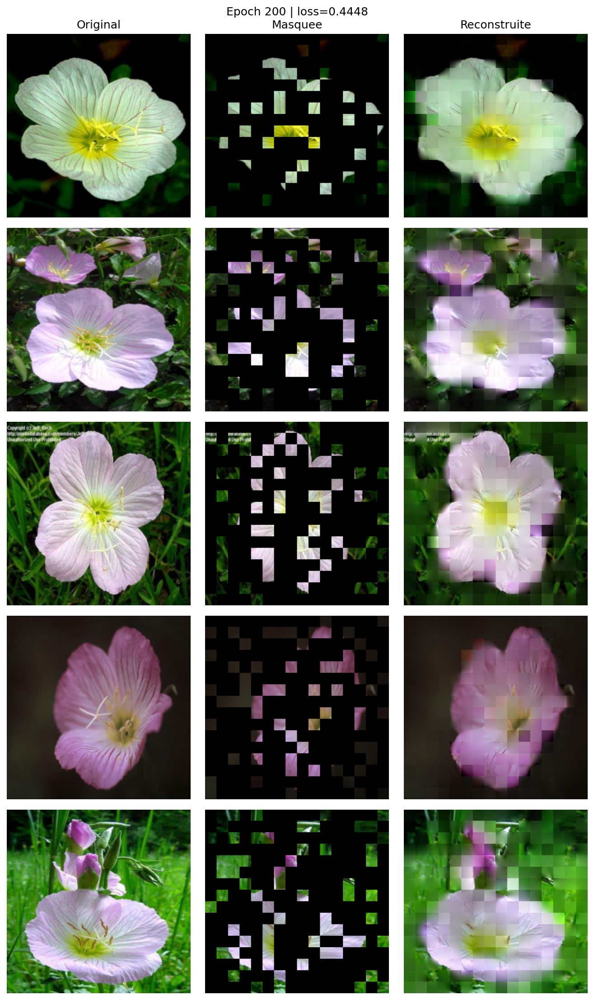
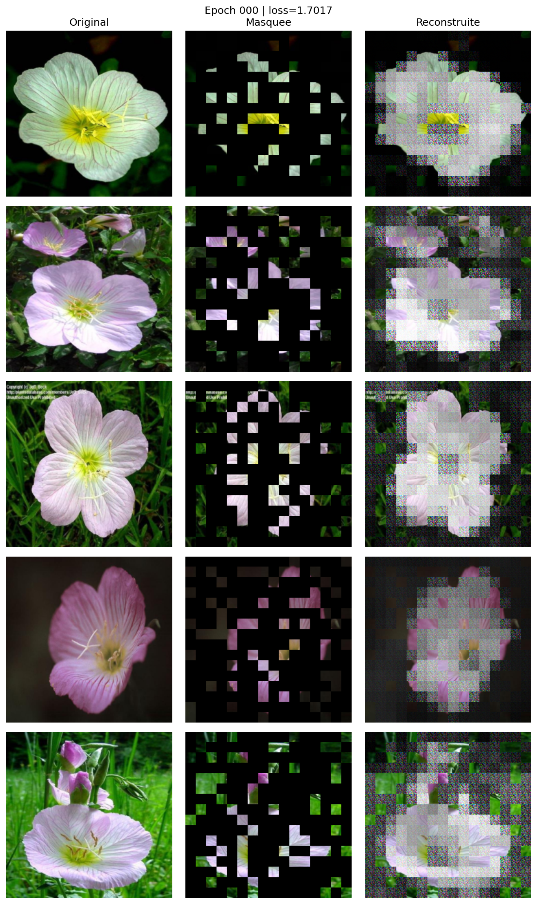
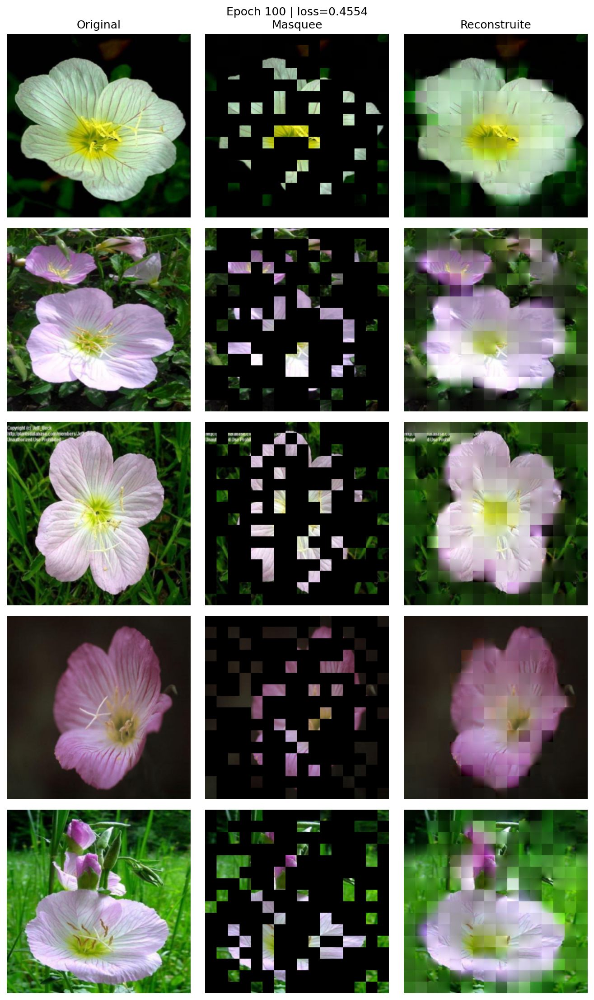
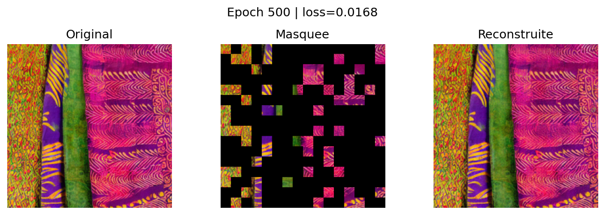
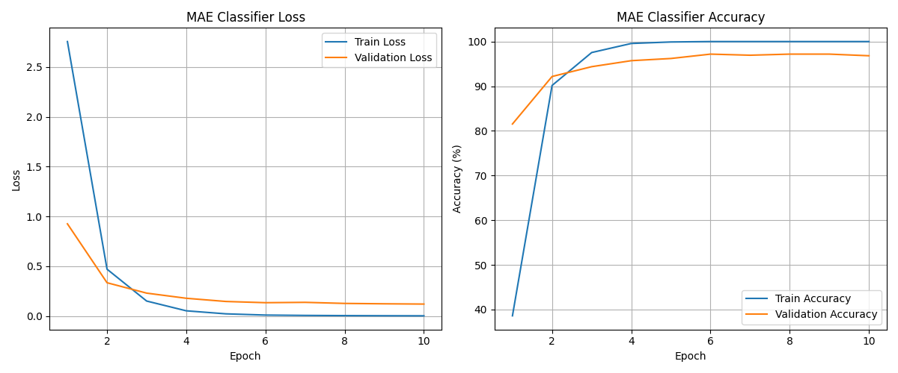
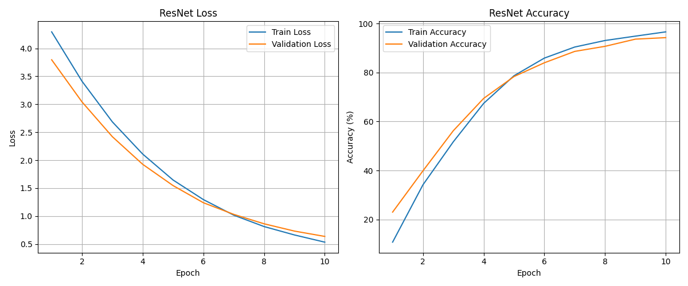

# Masked Autoencoder (MAE) from scratch

> A PyTorch implementation of a Vision Transformer Masked Autoencoder, trained to reconstruct masked images, then reused as a feature extractor for classification and compared with a ResNet18 baseline.


Self-supervised learning project, built with Julien Excoffier.

<p align="center">
  
</p>

## What it does

1. **Pretraining.** Images are cut into 16×16 patches, a share of them is hidden, and a Transformer encoder / decoder learns to rebuild the missing pixels.
2. **Transfer.** The pretrained encoder is frozen or fine-tuned with a linear head to classify images.
3. **Comparison.** The MAE classifier is benchmarked against a ResNet18 trained on the same data.
4. **Demo.** A Streamlit app shows reconstructions and predictions side by side.

## Model

| Component | Default |
|---|---|
| Input | 256×256 RGB, 16×16 patches (256 patches) |
| Encoder | 6 Transformer blocks, 8 heads, dim 512 |
| Masking | random, 50% of patches by default |
| Decoder | 6 Transformer blocks, 8 heads, dim 512, with learned mask tokens |
| Loss | MSE on masked patches, normalized pixels |
| Variant | optional torchvision ViT-B/16 encoder (`pretrained_main.py`) |

Everything (patch embedding, attention blocks, masking, decoder) is written by hand in [`src/model.py`](src/model.py).

## Datasets

- **Flowers** (102 categories) for reconstruction and classification
- **Japanese and Sri Lankan textiles** for reconstruction
- **Animals-10**, downloaded automatically with `kagglehub`

Expected layout: `data/raw/flowers/`, `data/raw/japanese_textiles/`, `data/raw/sri_lankan_textiles/`.

## Getting started

```bash
python -m venv .venv && source .venv/bin/activate
pip install -r requirements.txt

python main.py              # MAE pretraining (reconstruction)
python pretrained_main.py   # classification on top of the MAE encoder
python resnet_main.py       # ResNet18 baseline
python overfit.py           # sanity check: overfit a tiny subset
streamlit run streamlit_app.py
```

Checkpoints go to `outputs/checkpoints/`, reconstructions and curves to `outputs/`.

## Results

| Reconstruction over training | Overfit sanity check |
|---|---|
|   |  |

| MAE classifier | ResNet18 baseline |
|---|---|
|  |  |

## Project layout

```
src/model.py          MAE: patch embedding, Transformer blocks, encoder, decoder
src/data.py           datasets, splits and loaders
src/train.py          training loop
src/visualisation.py  reconstruction figures
main.py               pretraining entry point
pretrained_main.py    MAE encoder + classification head
resnet_main.py        ResNet18 baseline
streamlit_app.py      interactive demo
demo/                 saved figures
```

## Reference

He et al., *Masked Autoencoders Are Scalable Vision Learners*, CVPR 2022.
